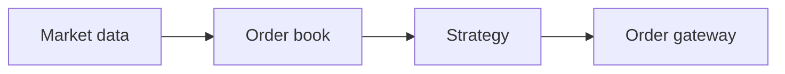

This draft is a test fixture and a writing reference. It is never published.

## Sidenotes

A markout compares the fill price with the mid price some time later.Use the mid at $t + 100\,\mu s$, not the last trade price. A positive markout means the fill was good for us.

## Math

Inline math looks like $m_t = s \cdot (p_{t+\Delta} - p_t)$. Write `\$` for a literal dollar sign, as in \$5.

$$
\bar{m} = \frac{1}{N} \sum_{i=1}^{N} s_i \left(p_{t_i+\Delta} - p_{t_i}\right)
$$

## Code

```cpp
template <typename T, std::size_t N>
class SpscQueue {
  std::array<T, N> buf_;
  alignas(64) std::atomic<std::size_t> head_{0};
  alignas(64) std::atomic<std::size_t> tail_{0};
};
```

```rust
fn markout(side: f64, fill: f64, mid_later: f64) -> f64 {
    side * (mid_later - fill) // positive is good
}
```

## Table

| Venue | Fills | Markout, bps |
|---|---:|---:|
| A | 1,204 | 0.82 |
| B | 877 | −0.31 |

## Diagram



> A quotation looks like this.
