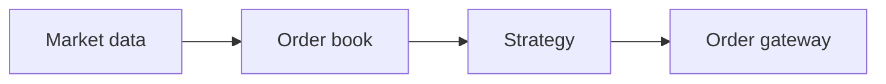

# Personal Site Implementation Plan

> **For Claude:** REQUIRED SUB-SKILL: Use superpowers:executing-plans to implement this plan task-by-task.

**Goal:** Replace the al-folio fork with a custom Hugo site (profile + technical blog) in the "engineering computation pad" style, deployed to GitHub Pages by GitHub Actions.

**Architecture:** Hugo 0.166.0 (pinned in devbox) renders Markdown with build-time KaTeX math and Chroma highlighting. Custom templates use Hugo's new layout tree (`layouts/*.html`, `layouts/_partials`, `layouts/_shortcodes`, `layouts/_markup`). A pytest suite (run with uv) builds the site into temp dirs and asserts on the HTML. CI runs the same devbox scripts, then deploys with `actions/deploy-pages`.

**Tech Stack:** Hugo 0.166.0, devbox, uv + pytest + BeautifulSoup, KaTeX 0.18.4 CSS, Mermaid 12.2.0 (ES module), Literata + JetBrains Mono (OFL), GitHub Actions.

**Design:** `docs/plans/2026-10-27-personal-site-design.md`

**Conventions:**
- Run every command from the repo root: `/Users/ssbars/Documents/repos_scaevolabars/scaevolabars.github.io`.
- Branch: `hugo-site`. Commit messages: short imperative, no Claude co-author lines.
- `hugo` only exists inside devbox. Run tests with `devbox run test`, not bare `pytest`.
- Hugo template gotcha: `{}` shortcodes pass output through Markdown and drop raw HTML (goldmark `unsafe = false`). Always use ``.

---

### Task 1: Clean slate and toolchain

**Files:**
- Delete: every tracked file except `docs/`
- Create: `.gitignore`, `devbox.json`, `devbox.lock`, `.python-version`, `pyproject.toml`, `uv.lock`

**Step 1: Remove al-folio**

```bash
git rm -r -q -- . ':(exclude)docs'
git clean -ndX   # list ignored leftovers (e.g. _site/, .jekyll-cache/); remove them with git clean -fdX if any
ls -A            # expect: .git docs
```

**Step 2: Write `.gitignore`**

```gitignore
/public/
/resources/_gen/
/.hugo_build.lock
/static/vendor/
/.vendor-stamp
/.devbox/
/.venv/
__pycache__/
.pytest_cache/
.DS_Store
```

**Step 3: Write `devbox.json`, then install**

```json
{
  "$schema": "https://raw.githubusercontent.com/jetify-com/devbox/0.18.5/.schema/devbox.schema.json",
  "packages": ["hugo@0.166.0", "uv@0.12.22"],
  "shell": {
    "scripts": {
      "vendor": "scripts/vendor.sh",
      "dev": ["scripts/vendor.sh", "hugo server --buildDrafts --disableFastRender"],
      "build": ["scripts/vendor.sh", "hugo --gc --minify --panicOnWarning"],
      "test": "uv run --locked pytest -m 'not content'",
      "check-content": "uv run --locked pytest -m content"
    }
  }
}
```

Run: `devbox install && devbox run -- hugo version`
Expected: `hugo v0.166.0...`

**Step 4: Python test project with uv**

```bash
uv init --bare --name scaevolabars-site
uv python pin 3.12
uv add --dev pytest beautifulsoup4
```

Then append to `pyproject.toml`:

```toml
[tool.pytest.ini_options]
testpaths = ["tests"]
addopts = ["--strict-markers"]
markers = ["content: fails while PLACEHOLDER text remains in the built site"]
```

**Step 5: Commit**

```bash
git add -A
git commit -m "Remove al-folio and add devbox and uv toolchain"
```

---

### Task 2: Third-party assets

**Files:**
- Create: `scripts/vendor.sh`, `scripts/fonts.sh`
- Create (generated, committed): `static/fonts/*.woff2`, `static/fonts/*-OFL.txt`

**Step 1: Write `scripts/vendor.sh`** (checksums were computed on 2026-10-27 from the npm tarballs)

```bash
#!/usr/bin/env bash
# Fetch pinned third-party files into static/vendor/ (git-ignored).
# KaTeX CSS must match the KaTeX version inside Hugo: Hugo 0.166.0 bundles 0.18.4.
set -euo pipefail

KATEX_VERSION=0.18.4
KATEX_SHA256=0090b1ebccc77d1402ec95e85ee539e1da514d6cd6934156c00baf39dcb0e3aa
MERMAID_VERSION=12.2.0
MERMAID_SHA256=071914164d0f6d53e5c26a10a220230d4ae8d37ed0f2263fbf072266f0af3a0a

root="$(cd "$(dirname "$0")/.." && pwd)"
out="$root/static/vendor"
# The stamp stays out of static/: Hugo publishes dotfiles from there.
stamp="$root/.vendor-stamp"
want="katex-$KATEX_VERSION mermaid-$MERMAID_VERSION"

if [[ -f "$stamp" && "$(cat "$stamp")" == "$want" &&
      -f "$out/katex/katex.min.css" && -f "$out/mermaid/mermaid.esm.min.mjs" ]]; then
  exit 0
fi

tmp="$(mktemp -d)"
trap 'rm -rf "$tmp"' EXIT

sha256() {
  if command -v sha256sum >/dev/null; then sha256sum "$1"; else shasum -a 256 "$1"; fi | cut -d' ' -f1
}

fetch() {
  local name=$1 version=$2 sha=$3
  local tgz="$tmp/$name.tgz"
  curl -fsSL --retry 3 --retry-connrefused "https://registry.npmjs.org/$name/-/$name-$version.tgz" -o "$tgz"
  if [[ "$(sha256 "$tgz")" != "$sha" ]]; then
    echo "vendor: $name $version checksum mismatch" >&2
    exit 1
  fi
  mkdir -p "$tmp/$name"
  tar -xzf "$tgz" -C "$tmp/$name"
}

fetch katex "$KATEX_VERSION" "$KATEX_SHA256"
fetch mermaid "$MERMAID_VERSION" "$MERMAID_SHA256"

rm -rf "$out" "$stamp"
mkdir -p "$out/katex/fonts" "$out/mermaid/chunks/mermaid.esm.min"
cp "$tmp/katex/package/dist/katex.min.css" "$out/katex/"
cp "$tmp/katex/package/dist/fonts/"*.woff2 "$out/katex/fonts/"
cp "$tmp/mermaid/package/dist/mermaid.esm.min.mjs" "$out/mermaid/"
cp "$tmp/mermaid/package/dist/chunks/mermaid.esm.min/"*.mjs "$out/mermaid/chunks/mermaid.esm.min/"
echo "$want" > "$stamp"
echo "vendor: $want"
```

Run: `chmod +x scripts/vendor.sh && scripts/vendor.sh && ls static/vendor/katex static/vendor/mermaid`
Expected: `vendor: katex-0.18.4 mermaid-12.2.0`, `katex.min.css fonts`, `chunks mermaid.esm.min.mjs`. A second run prints nothing (stamp hit: `.vendor-stamp` at the repo root matches and the key files exist). After `rm -rf static/vendor`, the next run fetches again.

**Step 2: Write `scripts/fonts.sh`**

```bash
#!/usr/bin/env bash
# Rebuild the font subsets in static/fonts/. Outputs are committed; run only to change them.
# Run as `devbox run -- scripts/fonts.sh`: it needs the pinned uvx.
set -euo pipefail

GOOGLE_FONTS_REV=ddf386ba1b9fbc6b2c818f1ddcd9148f54ced94b
FONTTOOLS_VERSION=4.68.0
BROTLI_VERSION=1.2.1

root="$(cd "$(dirname "$0")/.." && pwd)"
out="$root/static/fonts"
src="https://raw.githubusercontent.com/google/fonts/$GOOGLE_FONTS_REV/ofl"
tmp="$(mktemp -d)"
trap 'rm -rf "$tmp"' EXIT
mkdir -p "$out"

curl -fsSL "$src/literata/Literata%5Bopsz,wght%5D.ttf" -o "$tmp/literata.ttf"
curl -fsSL "$src/literata/Literata-Italic%5Bopsz,wght%5D.ttf" -o "$tmp/literata-italic.ttf"
curl -fsSL "$src/jetbrainsmono/JetBrainsMono%5Bwght%5D.ttf" -o "$tmp/jetbrains-mono.ttf"
curl -fsSL "$src/literata/OFL.txt" -o "$tmp/Literata-OFL.txt"
curl -fsSL "$src/jetbrainsmono/OFL.txt" -o "$tmp/JetBrainsMono-OFL.txt"

# Keep these ranges in sync with the unicode-range values in assets/css/main.css.
latin="U+0000-017F,U+0370-03FF,U+2000-206F,U+2070-209F,U+20AC,U+2100-214F,U+2190-21FF,U+2200-22FF,U+25A0-25FF,U+FFFD"
cyrillic="U+0400-045F,U+0490-0491,U+04B0-04B1"
mono="U+0000-017F,U+0370-03FF,U+0400-045F,U+2000-206F,U+2070-209F,U+20AC,U+2190-21FF,U+2200-22FF,U+2500-257F,U+25A0-25FF"

subset() {
  uvx --from "fonttools[woff]==$FONTTOOLS_VERSION" --with "brotli==$BROTLI_VERSION" \
    pyftsubset "$1" --unicodes="$2" --layout-features='*' --flavor=woff2 --output-file="$3"
}

subset "$tmp/literata.ttf" "$latin" "$out/literata.woff2"
subset "$tmp/literata.ttf" "$cyrillic" "$out/literata-cyrillic.woff2"
subset "$tmp/literata-italic.ttf" "$latin" "$out/literata-italic.woff2"
subset "$tmp/literata-italic.ttf" "$cyrillic" "$out/literata-italic-cyrillic.woff2"
subset "$tmp/jetbrains-mono.ttf" "$mono" "$out/jetbrains-mono.woff2"
cp "$tmp/Literata-OFL.txt" "$tmp/JetBrainsMono-OFL.txt" "$out/"
ls -l "$out"
```

Run: `chmod +x scripts/fonts.sh && devbox run -- scripts/fonts.sh`
Expected: five `.woff2` files and two OFL texts. Check sizes; if `literata.woff2` is over ~300 KB, report it before going on (option: drop the `opsz` axis with `fonttools varLib.instancer`).

**Step 3: Commit**

```bash
git add scripts static/fonts
git commit -m "Add scripts for pinned vendor files and font subsets"
```

---

### Task 3: Test harness, config and core templates

> **As built (commit 33130f6 and the review fixes after it):** the code is the reference for Task 3, not the blocks below. It differs in these points: `locale` replaces the deprecated `languageCode`; the paper-note field is `link`, because `url` is a reserved Hugo key; `layouts/home.rss.xml` limits the feed to posts and notes, so about/cv/projects stay in the sitemap (no `build.list`); a front-matter check runs from `baseof.html`; the tests check properties, not the exact sample content.

**Files:**
- Create: `tests/helpers.py`, `tests/conftest.py`, `tests/test_core.py`
- Create: `hugo.toml`
- Create: `layouts/baseof.html`, `layouts/home.html`, `layouts/page.html`, `layouts/section.html`, `layouts/taxonomy.html`, `layouts/term.html`, `layouts/404.html`
- Create: `layouts/_partials/{header,footer,title,entry-list,topic-links,check-topics,paper}.html`
- Create: `assets/css/main.css` (tokens only; Task 4 completes it), `assets/css/syntax.css` (comment only; Task 8 completes it)
- Create: `content/_index.md`, `content/posts/_index.md`, `content/notes/_index.md`, `content/about.md`, `content/cv.md`, `content/projects.md`
- Create: `content/posts/sample-features.md`, `content/posts/sample-older.md`, `content/notes/sample-note.md`
- Create: `archetypes/posts.md`, `archetypes/notes.md`, `static/favicon.svg`

**Step 1: Write `tests/helpers.py`**

```python
"""Shared helpers for the site tests."""

import subprocess
from pathlib import Path

from bs4 import BeautifulSoup

ROOT = Path(__file__).resolve().parent.parent


def hugo_build(source: Path, dest: Path, *extra: str) -> subprocess.CompletedProcess[str]:
    """Build the site at `source` into `dest` with the production flags."""
    return subprocess.run(
        ["hugo", "--gc", "--minify", "--panicOnWarning",
         "--source", str(source), "--destination", str(dest), *extra],
        capture_output=True,
        text=True,
        check=False,
    )


def page(site: Path, url: str) -> BeautifulSoup:
    """Parse the built file for a site URL such as "/posts/" or "/404.html"."""
    rel = url.lstrip("/")
    path = site / rel if rel.endswith(".html") else site / rel / "index.html"
    return BeautifulSoup(path.read_text(encoding="utf-8"), "html.parser")
```

**Step 2: Write `tests/conftest.py`**

```python
import subprocess
from pathlib import Path

import pytest

from helpers import ROOT, hugo_build


@pytest.fixture(scope="session", autouse=True)
def vendor() -> None:
    subprocess.run([str(ROOT / "scripts" / "vendor.sh")], check=True)


@pytest.fixture(scope="session")
def prod_site(tmp_path_factory: pytest.TempPathFactory) -> Path:
    dest = tmp_path_factory.mktemp("prod")
    result = hugo_build(ROOT, dest)
    assert result.returncode == 0, result.stderr + result.stdout
    return dest


@pytest.fixture(scope="session")
def draft_site(tmp_path_factory: pytest.TempPathFactory) -> Path:
    dest = tmp_path_factory.mktemp("drafts")
    result = hugo_build(ROOT, dest, "--buildDrafts")
    assert result.returncode == 0, result.stderr + result.stdout
    return dest
```

**Step 3: Write the failing tests `tests/test_core.py`**

```python
import shutil
from pathlib import Path

import pytest

from helpers import ROOT, hugo_build, page

NAV = ["Writing", "Notes", "Projects", "CV", "About"]
PAGES = ["/", "/posts/", "/notes/", "/about/", "/cv/", "/projects/", "/404.html"]
COPY_IGNORE = shutil.ignore_patterns(
    ".git", ".devbox", ".venv", "public", "resources", ".pytest_cache", "__pycache__"
)


def test_production_build_writes_home(prod_site: Path) -> None:
    assert (prod_site / "index.html").is_file()


@pytest.mark.parametrize("url", PAGES)
def test_page_has_nav_skip_link_and_stylesheet(prod_site: Path, url: str) -> None:
    soup = page(prod_site, url)
    assert [a.get_text(strip=True) for a in soup.select("nav.band__nav a")] == NAV
    assert soup.select_one("a.skip")["href"] == "#main"
    assert soup.select_one("main#main") is not None
    assert soup.select_one("link[rel=stylesheet][integrity]") is not None


def test_nav_marks_current_section(draft_site: Path) -> None:
    archive = page(draft_site, "/posts/")
    assert archive.select_one("nav.band__nav a[aria-current=page]").get_text() == "Writing"
    post = page(draft_site, "/posts/sample-features/")
    assert post.select_one("nav.band__nav a[aria-current=true]").get_text() == "Writing"


def test_home_band_holds_name_and_intro(prod_site: Path) -> None:
    band = page(prod_site, "/").select_one("header.band--home")
    assert band.select_one("h1.band__title").get_text() == "Sergey Bars"
    assert "trading systems" in band.select_one(".band__lede").get_text()


def test_home_shows_empty_state_without_entries(prod_site: Path) -> None:
    empties = page(prod_site, "/").select("p.empty")
    assert len(empties) == 2
    assert empties[0].select_one('a[href="/index.xml"]') is not None


def test_home_lists_latest_posts_and_notes(draft_site: Path) -> None:
    soup = page(draft_site, "/")
    posts = [a.get_text() for a in soup.select("section[aria-labelledby=latest-posts] .entry__title")]
    assert posts == ["Sample post with every feature", "Sample post from an earlier year"]
    notes = [a.get_text() for a in soup.select("section[aria-labelledby=latest-notes] .entry__title")]
    assert notes == ["Sample note: Attention Is All You Need"]


def test_archive_groups_posts_by_year_newest_first(draft_site: Path) -> None:
    soup = page(draft_site, "/posts/")
    assert [h.get_text() for h in soup.select("h2.year__label")] == ["2026", "2025"]
    assert soup.select("section.year")[0].select_one(".entry__date").get_text() == "27 Oct"


def test_post_shows_date_and_topic_links(draft_site: Path) -> None:
    meta = page(draft_site, "/posts/sample-features/").select_one("p.meta")
    assert meta.select_one("time")["datetime"] == "2026-10-27"
    assert meta.select_one("time").get_text() == "27 October 2026"
    links = {a.get_text(): a["href"] for a in meta.select("a")}
    assert links == {"Trading systems": "/topics/trading/", "Low-latency C++/Rust": "/topics/low-latency/"}


def test_topic_page_uses_display_name(draft_site: Path) -> None:
    soup = page(draft_site, "/topics/low-latency/")
    assert soup.select_one("h1.page-title").get_text() == "Low-latency C++/Rust"
    assert soup.title.get_text() == "Low-latency C++/Rust | Sergey Bars"
    assert "Sample post with every feature" in soup.select_one(".entries").get_text()


def test_unknown_topic_fails_the_build(tmp_path: Path) -> None:
    src = tmp_path / "src"
    shutil.copytree(ROOT, src, ignore=COPY_IGNORE)
    (src / "content" / "posts" / "bad-topic.md").write_text(
        "---\ntitle: Bad topic\ndate: 2026-01-01\ntopics: [astrology]\n---\nText.\n",
        encoding="utf-8",
    )
    result = hugo_build(src, tmp_path / "out")
    assert result.returncode != 0
    assert 'unknown topic "astrology"' in result.stderr + result.stdout


def test_note_shows_paper_reference(draft_site: Path) -> None:
    paper = page(draft_site, "/notes/sample-note/").select_one("p.paper")
    assert paper.select_one("a")["href"] == "https://arxiv.org/abs/1706.03762"
    assert paper.get_text() == "Notes on Attention Is All You Need, Vaswani et al. (2017)."


def test_drafts_are_not_published(prod_site: Path) -> None:
    assert not (prod_site / "posts" / "sample-features").exists()
    assert not (prod_site / "notes" / "sample-note").exists()


def test_404_links_home(prod_site: Path) -> None:
    assert page(prod_site, "/404.html").select_one('.prose a[href="/"]') is not None
```

**Step 4: Run to verify they fail**

Run: `devbox run test`
Expected: FAIL (errors in `prod_site`: Hugo cannot find a config file).

**Step 5: Write `hugo.toml`**

```toml
baseURL = "https://scaevolabars.github.io/"
languageCode = "en"
title = "Sergey Bars"
enableRobotsTXT = true

[params]
  description = "Sergey Bars writes about trading systems, low-latency C++ and Rust, GPUs, foundation models, robotics, physics and math."
  github = "scaevolabars"

  # Allowed topics: slug = display name. Any other topic fails the build.
  [params.topics]
    trading = "Trading systems"
    low-latency = "Low-latency C++/Rust"
    gpu = "GPU / CUDA"
    algorithms = "Algorithms"
    math = "Math"
    physics = "Physics"
    foundation-models = "Foundation models"
    robotics = "Robotics"

[taxonomies]
  topic = "topics"

[markup]
  [markup.goldmark.extensions.passthrough]
    enable = true
    [markup.goldmark.extensions.passthrough.delimiters]
      block = [['$$', '$$'], ['\[', '\]']]
      inline = [['$', '$'], ['\(', '\)']]
  [markup.highlight]
    noClasses = false
    codeFences = true
    guessSyntax = false

[[menus.main]]
  name = "Writing"
  pageRef = "/posts"
  weight = 10
[[menus.main]]
  name = "Notes"
  pageRef = "/notes"
  weight = 20
[[menus.main]]
  name = "Projects"
  pageRef = "/projects"
  weight = 30
[[menus.main]]
  name = "CV"
  pageRef = "/cv"
  weight = 40
[[menus.main]]
  name = "About"
  pageRef = "/about"
  weight = 50
```

**Step 6: Write `layouts/baseof.html`**

```html
<!doctype html>
<html lang="en">
<head>
  <meta charset="utf-8">
  <meta name="viewport" content="width=device-width, initial-scale=1">
  {{- $title := partial "title.html" . }}
  {{- $description := .Description | default site.Params.description }}
  <title>{{ if .IsHome }}{{ site.Title }}{{ else }}{{ $title }} | {{ site.Title }}{{ end }}</title>
  <meta name="description" content="{{ $description }}">
  <link rel="canonical" href="{{ .Permalink }}">
  <meta property="og:title" content="{{ $title }}">
  <meta property="og:description" content="{{ $description }}">
  <meta property="og:url" content="{{ .Permalink }}">
  <meta property="og:type" content="{{ if .IsPage }}article{{ else }}website{{ end }}">
  <meta name="theme-color" media="(prefers-color-scheme: light)" content="#EEF2E9">
  <meta name="theme-color" media="(prefers-color-scheme: dark)" content="#1C211E">
  <link rel="icon" href="{{ "favicon.svg" | relURL }}" type="image/svg+xml">
  {{- with site.Home.OutputFormats.Get "rss" }}
  <link rel="alternate" type="application/rss+xml" href="{{ .RelPermalink }}" title="{{ site.Title }}">
  {{- end }}
  <link rel="preload" href="{{ "fonts/literata.woff2" | relURL }}" as="font" type="font/woff2" crossorigin>
  {{- $css := slice (resources.Get "css/main.css") (resources.Get "css/syntax.css") | resources.Concat "css/site.css" | minify | fingerprint }}
  <link rel="stylesheet" href="{{ $css.RelPermalink }}" integrity="{{ $css.Data.Integrity }}">
  {{- /* Render the content first so render hooks can set the hasMath flag. */}}
  {{- $noop := .WordCount }}
  {{- if .Store.Get "hasMath" }}
  <link rel="stylesheet" href="{{ "vendor/katex/katex.min.css" | relURL }}">
  {{- end }}
</head>
<body>
  <a class="skip" href="#main">Skip to content</a>
  {{ partial "header.html" . }}
  <main id="main">
    {{ block "main" . }}{{ end }}
  </main>
  {{ partial "footer.html" . }}
  {{- if .Store.Get "hasMermaid" }}
  <script type="module" src="{{ "js/diagrams.mjs" | relURL }}"></script>
  {{- end }}
</body>
</html>
```

**Step 7: Write the partials**

`layouts/_partials/header.html`:

```html
{{- $here := .RelPermalink -}}
<header class="band{{ if .IsHome }} band--home{{ end }}">
  <div class="wrap band__bar">
    {{- if not .IsHome }}
    <a class="band__name" href="{{ "/" | relURL }}">{{ site.Title }}</a>
    {{- end }}
    <nav class="band__nav" aria-label="Main">
      <ul>
        {{- range site.Menus.main }}
        {{- $exact := eq $here .URL }}
        {{- $inside := and (not $exact) (hasPrefix $here .URL) }}
        <li><a href="{{ .URL }}"{{ if $exact }} aria-current="page"{{ else if $inside }} aria-current="true"{{ end }}>{{ .Name }}</a></li>
        {{- end }}
      </ul>
    </nav>
  </div>
  {{- if .IsHome }}
  <div class="wrap band__intro">
    <h1 class="band__title">{{ site.Title }}</h1>
    <div class="band__lede">{{ .Content }}</div>
  </div>
  {{- end }}
</header>
```

`layouts/_partials/footer.html`:

```html
<footer class="foot">
  <div class="wrap">
    <ul>
      <li>{{ site.Title }}, {{ now.Year }}</li>
      <li><a href="{{ "index.xml" | relURL }}">RSS feed</a></li>
      {{- with site.Params.github }}
      <li><a href="https://github.com/{{ . }}">GitHub</a></li>
      {{- end }}
    </ul>
  </div>
</footer>
```

`layouts/_partials/title.html` (returns the display title; topic pages use the name from `params.topics`):

```html
{{- $title := .Title -}}
{{- if eq .Kind "term" -}}
  {{- with index site.Params.topics .Data.Term -}}{{- $title = . -}}{{- end -}}
{{- end -}}
{{- return $title -}}
```

`layouts/_partials/entry-list.html` (context: `dict "pages" <pages> "format" <date layout>`):

```html
<ul class="entries">
  {{- range .pages }}
  <li class="entry">
    <time class="entry__date" datetime="{{ .Date.Format "2006-01-02" }}">{{ .Date.Format $.format }}</time>
    <a class="entry__title" href="{{ .RelPermalink }}">{{ .Title }}</a>
    {{- with .Params.topics }}
    <span class="entry__topics">{{ partial "topic-links.html" . }}</span>
    {{- end }}
  </li>
  {{- end }}
</ul>
```

`layouts/_partials/topic-links.html` (context: slice of topic slugs):

```html
{{- range $i, $t := . -}}
{{- if $i }}, {{ end -}}
<a href="{{ printf "topics/%s/" (urlize $t) | relURL }}">{{ index site.Params.topics $t | default $t }}</a>
{{- end -}}
```

`layouts/_partials/check-topics.html`:

```html
{{- range .Params.topics -}}
  {{- if not (isset site.Params.topics .) -}}
    {{- errorf "%s: unknown topic %q. Use a slug from params.topics in hugo.toml." $.File.Path . -}}
  {{- end -}}
{{- end -}}
```

`layouts/_partials/paper.html`:

```html
{{- with .Params.paper }}
<p class="paper">Notes on {{ with $.Params.url }}<a href="{{ . }}">{{ $.Params.paper }}</a>{{ else }}{{ . }}{{ end }}{{ with $.Params.authors }}, {{ . }}{{ end }}{{ with $.Params.year }} ({{ . }}){{ end }}.</p>
{{- end }}
```

**Step 8: Write the page-kind templates**

`layouts/home.html`:

```html
{{ define "main" }}
{{- $posts := where site.RegularPages "Section" "posts" }}
{{- $notes := where site.RegularPages "Section" "notes" }}
<div class="wrap">
  <section class="latest" aria-labelledby="latest-posts">
    <h2 class="latest__title" id="latest-posts">Writing</h2>
    {{- with first 5 $posts }}
    {{ partial "entry-list.html" (dict "pages" . "format" "02 Jan 2006") }}
    <p class="latest__more"><a href="{{ "posts/" | relURL }}">All posts</a></p>
    {{- else }}
    <p class="empty">No posts yet. Follow the <a href="{{ "index.xml" | relURL }}">RSS feed</a> to get the first one.</p>
    {{- end }}
  </section>
  <section class="latest" aria-labelledby="latest-notes">
    <h2 class="latest__title" id="latest-notes">Notes</h2>
    {{- with first 3 $notes }}
    {{ partial "entry-list.html" (dict "pages" . "format" "02 Jan 2006") }}
    <p class="latest__more"><a href="{{ "notes/" | relURL }}">All notes</a></p>
    {{- else }}
    <p class="empty">No paper notes yet.</p>
    {{- end }}
  </section>
</div>
{{ end }}
```

`layouts/page.html`:

```html
{{ define "main" }}
{{- partial "check-topics.html" . }}
<article class="wrap">
  <header class="entry-head">
    <h1 class="page-title">{{ .Title }}</h1>
    {{- if in (slice "posts" "notes") .Section }}
    <p class="meta">
      <time datetime="{{ .Date.Format "2006-01-02" }}">{{ .Date.Format "2 January 2006" }}</time>
      {{- with .Params.topics }}, in {{ partial "topic-links.html" . }}{{ end }}
    </p>
    {{- end }}
    {{- if eq .Section "notes" }}{{ partial "paper.html" . }}{{ end }}
  </header>
  <div class="prose">
    {{ .Content }}
  </div>
</article>
{{ end }}
```

`layouts/section.html`:

```html
{{ define "main" }}
<div class="wrap">
  <h1 class="page-title">{{ .Title }}</h1>
  {{- with .Content }}<div class="prose section-intro">{{ . }}</div>{{ end }}
  {{- range .Pages.GroupByDate "2006" }}
  <section class="year" aria-labelledby="year-{{ .Key }}">
    <h2 class="year__label" id="year-{{ .Key }}">{{ .Key }}</h2>
    {{ partial "entry-list.html" (dict "pages" .Pages "format" "02 Jan") }}
  </section>
  {{- else }}
  <p class="empty">Nothing here yet. Follow the <a href="{{ "index.xml" | relURL }}">RSS feed</a> to get new entries.</p>
  {{- end }}
</div>
{{ end }}
```

`layouts/term.html`:

```html
{{ define "main" }}
<div class="wrap">
  <h1 class="page-title">{{ partial "title.html" . }}</h1>
  {{ partial "entry-list.html" (dict "pages" .Pages "format" "02 Jan 2006") }}
</div>
{{ end }}
```

`layouts/taxonomy.html`:

```html
{{ define "main" }}
<div class="wrap">
  <h1 class="page-title">Topics</h1>
  <ul class="topic-list">
    {{- range $slug, $name := site.Params.topics }}
    {{- with site.GetPage (printf "/topics/%s" $slug) }}
    <li><a href="{{ .RelPermalink }}">{{ $name }}</a> <span class="count">{{ len .Pages }}</span></li>
    {{- end }}
    {{- end }}
  </ul>
</div>
{{ end }}
```

`layouts/404.html`:

```html
{{ define "main" }}
<div class="wrap">
  <h1 class="page-title">Page not found</h1>
  <div class="prose">
    <p>This address has no page. Go to the <a href="{{ "/" | relURL }}">home page</a> or the <a href="{{ "posts/" | relURL }}">list of posts</a>.</p>
  </div>
</div>
{{ end }}
```

**Step 9: CSS stubs**

`assets/css/main.css` (Task 4 replaces it):

```css
/* tokens:light */
:root { --paper: #EEF2E9; --grid: #CFDACB; --ink: #22272B; --muted: #5B635D; --pencil: #2B5C8F; --code-bg: #E3E9DF; }
/* end tokens */
```

`assets/css/syntax.css` (Task 8 replaces it):

```css
/* Code highlighting. */
```

**Step 10: Content**

`content/_index.md`:

```markdown
---
title: "Sergey Bars"
---
PLACEHOLDER: one sentence about what you do now, for example your role and where you work.

This is my notebook on trading systems, low-latency C++ and Rust, GPU programming, foundation models, robotics, physics, and the math under them.
```

`content/posts/_index.md`:

```markdown
---
title: "Writing"
description: "Long posts on trading systems, low-latency code, GPUs, models, robotics and physics."
---
```

`content/notes/_index.md`:

```markdown
---
title: "Notes"
description: "Short notes on papers."
---
Short notes on papers: what the paper claims, how it works, and what I think of it.
```

`content/about.md` (`build.list: never` keeps the page out of feeds and lists):

```markdown
---
title: "About"
build:
  list: never
---
PLACEHOLDER: two or three paragraphs about you: what you work on now, what you worked on before, and what you want to hear about.

## Contact

- GitHub: [scaevolabars](https://github.com/scaevolabars)
- Email: PLACEHOLDER
```

`content/cv.md` and `content/projects.md` (Task 10 adds the shortcodes; until then the body is plain text):

```markdown
---
title: "CV"
build:
  list: never
---
PLACEHOLDER
```

```markdown
---
title: "Projects"
build:
  list: never
---
PLACEHOLDER
```

`content/posts/sample-features.md` (Tasks 5-9 rely on each part of it):

````markdown
---
title: "Sample post with every feature"
date: 2026-10-27
draft: true
description: "A draft that shows sidenotes, math, code, a table and a diagram."
topics: [trading, low-latency]
---

This draft is a test fixture and a writing reference. It is never published.

## Sidenotes

A markout compares the fill price with the mid price some time later.Use the mid at $t + 100\,\mu s$, not the last trade price. A positive markout means the fill was good for us.

## Math

Inline math looks like $m_t = s \cdot (p_{t+\Delta} - p_t)$. Write `\$` for a literal dollar sign, as in \$5.

$$
\bar{m} = \frac{1}{N} \sum_{i=1}^{N} s_i \left(p_{t_i+\Delta} - p_{t_i}\right)
$$

## Code

```cpp
template <typename T, std::size_t N>
class SpscQueue {
  std::array<T, N> buf_;
  alignas(64) std::atomic<std::size_t> head_{0};
  alignas(64) std::atomic<std::size_t> tail_{0};
};
```

```rust
fn markout(side: f64, fill: f64, mid_later: f64) -> f64 {
    side * (mid_later - fill) // positive is good
}
```

## Table

| Venue | Fills | Markout, bps |
|---|---:|---:|
| A | 1,204 | 0.82 |
| B | 877 | −0.31 |

## Diagram



> A quotation looks like this.
````

`content/posts/sample-older.md`:

```markdown
---
title: "Sample post from an earlier year"
date: 2025-12-05
draft: true
description: "A second draft so the archive shows two years."
topics: [gpu]
---
This draft exists so the archive shows posts grouped by year.
```

`content/notes/sample-note.md`:

```markdown
---
title: "Sample note: Attention Is All You Need"
date: 2026-10-20
draft: true
paper: "Attention Is All You Need"
authors: "Vaswani et al."
year: 2017
url: "https://arxiv.org/abs/1706.03762"
topics: [foundation-models]
---
**Claim.** Self-attention with no recurrence is enough for strong sequence transduction.

**Method.** Scaled dot-product attention: $\mathrm{softmax}(QK^\top / \sqrt{d_k})\,V$.

**Notes.** Write what you think of the paper here.
```

**Step 11: Archetypes and favicon**

`archetypes/posts.md`:

```markdown
---
title: "{{ replace .File.ContentBaseName "-" " " | title }}"
date: {{ .Date }}
draft: true
description: ""
topics: []
---
```

`archetypes/notes.md`:

```markdown
---
title: ""
date: {{ .Date }}
draft: true
paper: ""
authors: ""
year:
url: ""
topics: []
---
**Claim.**

**Method.**

**Notes.**
```

`static/favicon.svg`:

```svg
<svg xmlns="http://www.w3.org/2000/svg" viewBox="0 0 32 32">
  <style>
    .p{fill:#EEF2E9}.g{stroke:#CFDACB}.i{fill:#22272B}
    @media (prefers-color-scheme: dark){.p{fill:#1C211E}.g{stroke:#2A322D}.i{fill:#DDE4DA}}
  </style>
  <rect class="p" width="32" height="32" rx="4"/>
  <path class="g" stroke-width="1" d="M8 0v32M16 0v32M24 0v32M0 8h32M0 16h32M0 24h32"/>
  <text class="i" x="16" y="23" font-family="Georgia, serif" font-size="20" font-weight="700" text-anchor="middle">S</text>
</svg>
```

**Step 12: Stub the note shortcode**

The sample post uses ``, and Hugo fails on an unknown shortcode. Task 5 replaces this stub.

`layouts/_shortcodes/note.html`:

```html
{{- .Inner -}}
```

**Step 13: Run the tests**

Run: `devbox run test`
Expected: all `test_core.py` tests PASS.

**Step 14: Commit**

```bash
git add -A
git commit -m "Add Hugo config, core templates, content stubs and tests"
```

---

### Task 4: Visual system (CSS)

**Files:**
- Create: `tests/test_style.py`
- Replace: `assets/css/main.css`

**Step 1: Write the failing tests `tests/test_style.py`**

```python
import re

import pytest

from helpers import ROOT

CSS = (ROOT / "assets" / "css" / "main.css").read_text(encoding="utf-8")

# Text colour on background colour. Muted text never sits on the grid band (4.29:1 in light).
PAIRS = [
    ("ink", "paper"), ("muted", "paper"), ("pencil", "paper"),
    ("ink", "code-bg"), ("muted", "code-bg"), ("pencil", "code-bg"),
    ("ink", "grid"), ("pencil", "grid"),
]


def tokens(scheme: str) -> dict[str, str]:
    block = re.search(rf"/\* tokens:{scheme} \*/(.*?)/\* end tokens \*/", CSS, re.S)
    assert block, f"main.css has no tokens:{scheme} block"
    return dict(re.findall(r"--([a-z-]+):\s*(#[0-9A-Fa-f]{6})", block.group(1)))


def luminance(color: str) -> float:
    channels = [int(color[i : i + 2], 16) / 255 for i in (1, 3, 5)]
    linear = [c / 12.92 if c <= 0.03928 else ((c + 0.055) / 1.055) ** 2.4 for c in channels]
    return 0.2126 * linear[0] + 0.7152 * linear[1] + 0.0722 * linear[2]


def contrast(a: str, b: str) -> float:
    hi, lo = sorted((luminance(a), luminance(b)), reverse=True)
    return (hi + 0.05) / (lo + 0.05)


@pytest.mark.parametrize("scheme", ["light", "dark"])
@pytest.mark.parametrize(("fg", "bg"), PAIRS)
def test_text_contrast_meets_wcag_aa(scheme: str, fg: str, bg: str) -> None:
    colors = tokens(scheme)
    assert contrast(colors[fg], colors[bg]) >= 4.5


def test_font_files_in_css_exist() -> None:
    urls = re.findall(r'url\("(/fonts/[^"]+)"\)', CSS)
    assert len(urls) == 5
    for url in urls:
        assert (ROOT / "static" / url.lstrip("/")).is_file(), url
```

**Step 2: Run to verify they fail**

Run: `devbox run test -- tests/test_style.py` (if devbox does not forward args, use `devbox run -- uv run pytest tests/test_style.py`)
Expected: FAIL (`main.css has no tokens:dark block`, no font URLs).

**Step 3: Write `assets/css/main.css`**

```css
/* Engineering computation pad. Tokens are read by tests/test_style.py. */

/* tokens:light */
:root {
  --paper: #EEF2E9;
  --grid: #CFDACB;
  --ink: #22272B;
  --muted: #5B635D;
  --pencil: #2B5C8F;
  --code-bg: #E3E9DF;
}
/* end tokens */

@media (prefers-color-scheme: dark) {
  /* tokens:dark */
  :root {
    --paper: #1C211E;
    --grid: #2A322D;
    --ink: #DDE4DA;
    --muted: #9AA59C;
    --pencil: #93B8E0;
    --code-bg: #232A26;
  }
  /* end tokens */
}

:root {
  color-scheme: light dark;
  --serif: "Literata", Georgia, serif;
  --mono: "JetBrains Mono", ui-monospace, Menlo, Consolas, monospace;
  --measure: 66ch;
  --note-width: 15rem;
  --note-gap: 2.5rem;
  --gutter: 1.25rem;
  --cell: 5mm;
}

/* Fonts: self-hosted subsets, SIL Open Font License. Ranges match scripts/fonts.sh. */
@font-face {
  font-family: "Literata";
  src: url("/fonts/literata.woff2") format("woff2");
  font-weight: 200 900;
  font-style: normal;
  font-display: swap;
  unicode-range: U+0000-017F, U+0370-03FF, U+2000-206F, U+2070-209F, U+20AC, U+2100-214F, U+2190-21FF, U+2200-22FF, U+25A0-25FF, U+FFFD;
}
@font-face {
  font-family: "Literata";
  src: url("/fonts/literata-cyrillic.woff2") format("woff2");
  font-weight: 200 900;
  font-style: normal;
  font-display: swap;
  unicode-range: U+0400-045F, U+0490-0491, U+04B0-04B1;
}
@font-face {
  font-family: "Literata";
  src: url("/fonts/literata-italic.woff2") format("woff2");
  font-weight: 200 900;
  font-style: italic;
  font-display: swap;
  unicode-range: U+0000-017F, U+0370-03FF, U+2000-206F, U+2070-209F, U+20AC, U+2100-214F, U+2190-21FF, U+2200-22FF, U+25A0-25FF, U+FFFD;
}
@font-face {
  font-family: "Literata";
  src: url("/fonts/literata-italic-cyrillic.woff2") format("woff2");
  font-weight: 200 900;
  font-style: italic;
  font-display: swap;
  unicode-range: U+0400-045F, U+0490-0491, U+04B0-04B1;
}
@font-face {
  font-family: "JetBrains Mono";
  src: url("/fonts/jetbrains-mono.woff2") format("woff2");
  font-weight: 100 800;
  font-style: normal;
  font-display: swap;
}

/* Base */
*, *::before, *::after { box-sizing: border-box; }
html { -webkit-text-size-adjust: 100%; text-size-adjust: 100%; }
body {
  margin: 0;
  background: var(--paper);
  color: var(--ink);
  font-family: var(--serif);
  font-size: 1.125rem;
  line-height: 1.65;
  font-optical-sizing: auto;
}
a { color: var(--pencil); text-decoration-thickness: 1px; text-underline-offset: 0.18em; }
a:hover { text-decoration-thickness: 2px; }
:focus-visible { outline: 2px solid var(--pencil); outline-offset: 2px; }
h1, h2, h3, h4 { font-weight: 650; line-height: 1.2; text-wrap: balance; }
code, kbd, pre { font-family: var(--mono); font-size: 0.875em; }

.skip { position: absolute; top: -4rem; left: 1rem; z-index: 10; padding: 0.5rem 0.75rem; background: var(--paper); color: var(--ink); }
.skip:focus { top: 1rem; }
.vh { position: absolute; width: 1px; height: 1px; overflow: hidden; clip-path: inset(50%); white-space: nowrap; }

.wrap {
  max-width: calc(var(--measure) + var(--note-gap) + var(--note-width) + 2 * var(--gutter));
  margin-inline: auto;
  padding-inline: var(--gutter);
}

/* Grid band: the one bold element. Only ink and pencil text sit on it. */
.band {
  background-image:
    linear-gradient(to bottom, var(--grid) 1px, transparent 1px),
    linear-gradient(to right, var(--grid) 1px, transparent 1px);
  background-size: var(--cell) var(--cell);
  border-bottom: 2px solid var(--grid);
}
.band__bar { display: flex; flex-wrap: wrap; align-items: baseline; justify-content: space-between; gap: 0.5rem 1.5rem; padding-block: 1rem; }
.band--home .band__bar { justify-content: flex-end; }
.band__name { color: var(--ink); font-weight: 650; text-decoration: none; }
.band__nav ul { display: flex; flex-wrap: wrap; gap: 0.25rem 1.25rem; margin: 0; padding: 0; list-style: none; }
.band__nav a { color: var(--ink); text-decoration: none; }
.band__nav a:hover,
.band__nav a[aria-current] { text-decoration: underline 2px var(--pencil); text-underline-offset: 0.3em; }
.band__intro { padding-block: 2.5rem 3.5rem; }
.band__title { margin: 0 0 1.25rem; font-size: clamp(2.75rem, 8vw, 4.5rem); font-weight: 800; line-height: 1; letter-spacing: -0.015em; }
.band__lede { max-width: var(--measure); font-size: 1.25rem; line-height: 1.55; }
.band__lede p { margin: 0 0 0.75em; }
.band__lede p:last-child { margin-bottom: 0; }

/* Page */
main { padding-block: 2.5rem 4rem; }
.page-title { max-width: var(--measure); margin: 0 0 1.5rem; font-size: clamp(1.9rem, 4.5vw, 2.5rem); line-height: 1.15; }
.entry-head { margin-bottom: 2rem; }
.entry-head .page-title { margin-bottom: 0.5rem; }
.meta { margin: 0; color: var(--muted); font-variant-numeric: lining-nums tabular-nums; }
.meta a { color: inherit; }
.paper { max-width: var(--measure); margin: 0.5rem 0 0; }
.empty { color: var(--muted); }
.section-intro { margin-bottom: 2rem; }

/* Prose */
.prose { max-width: var(--measure); counter-reset: note; }
.prose > :first-child { margin-top: 0; }
.prose h2 { margin: 2.25em 0 0.6em; font-size: 1.5rem; }
.prose h3 { margin: 1.9em 0 0.5em; font-size: 1.25rem; }
.prose h4 { margin: 1.6em 0 0.5em; font-size: 1.125rem; }
.prose ul, .prose ol { padding-left: 1.4em; }
.prose li + li { margin-top: 0.25em; }
.prose img { max-width: 100%; height: auto; }
.prose blockquote { margin: 1.5em 0; padding-left: 1.25rem; border-left: 2px solid var(--grid); color: var(--muted); }
.prose hr { margin: 2.5em 0; border: 0; border-top: 2px solid var(--grid); }
.prose table { display: block; max-width: 100%; overflow-x: auto; border-collapse: collapse; font-size: 1rem; font-variant-numeric: lining-nums tabular-nums; }
.prose th, .prose td { padding: 0.4rem 0.9rem 0.4rem 0; border-bottom: 1px solid var(--grid); text-align: left; vertical-align: top; }
.prose th { border-bottom-width: 2px; font-weight: 650; }

/* Code */
:not(pre) > code { padding: 0.1em 0.3em; background: var(--code-bg); border-radius: 2px; }
pre { overflow-x: auto; padding: 1rem 1.25rem; background: var(--code-bg); line-height: 1.5; tab-size: 4; border-radius: 2px; }
.highlight, .prose > pre { margin: 1.5em 0; }
.highlight pre { margin: 0; }
pre.mermaid { padding: 0; background: none; font-family: var(--serif); }

/* Math */
.katex { font-size: 1.05em; }
.katex-display { margin: 1.5em 0; overflow-x: auto; overflow-y: hidden; }

/* Sidenotes: margin notes at 1100px and wider, tap-to-open below that. No JavaScript. */
.note-toggle { position: absolute; width: 1px; height: 1px; opacity: 0; }
.note-ref { counter-increment: note; color: var(--pencil); cursor: pointer; }
.note-ref::after { content: counter(note); padding-inline: 0.1em; font-size: 0.7em; line-height: 0; vertical-align: super; font-variant-numeric: lining-nums; }
.note-toggle:focus-visible + .note-ref { outline: 2px solid var(--pencil); outline-offset: 2px; }
.note { display: none; }
.note::before { content: counter(note) "\2002"; color: var(--pencil); font-variant-numeric: lining-nums; }
.note-toggle:checked + .note-ref + .note {
  display: block;
  margin: 0.75rem 0;
  padding-left: 1rem;
  border-left: 2px solid var(--grid);
  font-size: 1rem;
  line-height: 1.5;
}
@media (min-width: 1100px) {
  .note-toggle { display: none; }
  .note-ref { cursor: auto; }
  .note,
  .note-toggle:checked + .note-ref + .note {
    display: block;
    float: right;
    clear: right;
    width: var(--note-width);
    margin: 0.3rem calc(-1 * (var(--note-width) + var(--note-gap))) 0.75rem 0;
    padding-left: 0;
    border-left: 0;
    font-size: 0.875rem;
    line-height: 1.45;
  }
}

/* Entry lists: date column, title, topics. */
.latest + .latest { margin-top: 3rem; }
.latest__title, .year__label { margin: 0 0 0.75rem; font-size: 1.25rem; }
.latest__more { margin: 0.75rem 0 0; }
.year + .year { margin-top: 2.5rem; }
.entries {
  display: grid;
  grid-template-columns: max-content minmax(0, 1fr);
  column-gap: 1.25rem;
  row-gap: 0.6rem;
  max-width: calc(var(--measure) + 8rem);
  margin: 0;
  padding: 0;
  list-style: none;
}
.entry { display: grid; grid-column: 1 / -1; grid-template-columns: subgrid; }
.entry__date { color: var(--muted); font-variant-numeric: lining-nums tabular-nums; white-space: nowrap; }
.entry__title { grid-column: 2; color: var(--ink); font-weight: 600; text-decoration: none; }
.entry__title:hover { text-decoration: underline 1px; text-underline-offset: 0.18em; }
.entry__topics { grid-column: 2; color: var(--muted); font-size: 0.9rem; }
.entry__topics a { color: inherit; }

.topic-list { margin: 0; padding: 0; list-style: none; }
.topic-list li + li { margin-top: 0.4rem; }
.topic-list .count { color: var(--muted); font-variant-numeric: lining-nums tabular-nums; }

/* CV */
.cv-pdf { margin-top: 0; }
.cv-list { display: grid; grid-template-columns: max-content minmax(0, 1fr); gap: 0.6rem 1.5rem; margin: 0; }
.cv-list dt { color: var(--muted); font-variant-numeric: lining-nums tabular-nums; }
.cv-list dd { margin: 0; }
.cv-what { font-weight: 600; }
.cv-text { display: block; }
@media (max-width: 34rem) {
  .cv-list { grid-template-columns: minmax(0, 1fr); row-gap: 0.1rem; }
  .cv-list dd { margin-bottom: 0.9rem; }
}

/* Projects */
.project + .project { margin-top: 2.5rem; }
.prose .project__name { margin: 0 0 0.4rem; font-size: 1.25rem; }
.project__year { color: var(--muted); font-weight: 400; font-variant-numeric: lining-nums; }
.prose .project__links { display: flex; flex-wrap: wrap; gap: 0.25rem 1.25rem; margin: 0.5rem 0 0; padding: 0; list-style: none; }
.prose .project__links li + li { margin-top: 0; }

/* Footer */
.foot { padding-block: 1.25rem 2.5rem; border-top: 2px solid var(--grid); color: var(--muted); font-size: 0.9rem; }
.foot ul { display: flex; flex-wrap: wrap; gap: 0.25rem 1.5rem; margin: 0; padding: 0; list-style: none; }
.foot a { color: inherit; }
```

**Step 4: Run the tests**

Run: `devbox run test`
Expected: PASS (all of `test_core.py` and `test_style.py`).

**Step 5: Commit**

```bash
git add -A
git commit -m "Add engineering-pad visual system"
```

---

### Task 5: Sidenotes

**Files:**
- Create: `tests/test_features.py`
- Replace: `layouts/_shortcodes/note.html`

**Step 1: Write the failing test**

```python
from pathlib import Path

from helpers import page

SAMPLE = "/posts/sample-features/"


def test_sidenote_is_inline_and_toggleable(draft_site: Path) -> None:
    soup = page(draft_site, SAMPLE)
    toggle = soup.select_one(".prose p > input.note-toggle")
    assert toggle is not None and toggle["type"] == "checkbox"
    label = toggle.find_next_sibling("label")
    assert "note-ref" in label["class"] and label["for"] == toggle["id"]
    assert label.get_text() == "Note "
    note = label.find_next_sibling("span")
    assert "note" in note["class"] and note["role"] == "note"
```

**Step 2: Run to verify it fails**

Run: `devbox run -- uv run pytest tests/test_features.py -v`
Expected: FAIL (`toggle is None`).

**Step 3: Write `layouts/_shortcodes/note.html`** (one line, so no whitespace enters the paragraph; the call position gives a unique id; for a note inside another shortcode, Hugo reports the position relative to the parent's inner text, so the parent's position is added; CSS counters give the visible number)

```html
{{- $id := printf "note-%d-%d" .Position.LineNumber .Position.ColumnNumber -}}{{- with .Parent }}{{ $id = printf "%s-%d-%d" $id .Position.LineNumber .Position.ColumnNumber }}{{ end -}}<input type="checkbox" class="note-toggle" id="{{ $id }}"><label class="note-ref" for="{{ $id }}"><span class="vh">Note </span></label><span class="note" role="note">{{ .Inner | .Page.RenderString }}</span>{{- /* end */ -}}
```

**Step 4: Run the tests**

Run: `devbox run test`
Expected: PASS.

**Step 5: Commit**

```bash
git add -A
git commit -m "Add CSS-only sidenotes"
```

---

### Task 6: Math at build time

**Files:**
- Modify: `tests/test_features.py` (append)
- Create: `layouts/_markup/render-passthrough.html`

**Step 1: Append the failing tests**

```python
def test_math_renders_at_build_time(draft_site: Path) -> None:
    soup = page(draft_site, SAMPLE)
    assert soup.select_one(".prose .katex-display") is not None
    assert soup.select(".prose p .katex")
    assert soup.select_one(".note .katex") is not None
    assert soup.select_one('link[href="/vendor/katex/katex.min.css"]') is not None
    assert "$5" in soup.select_one(".prose").get_text()


def test_pages_without_math_skip_katex_css(prod_site: Path) -> None:
    assert page(prod_site, "/about/").select_one("link[href*=katex]") is None


def test_katex_css_matches_the_katex_inside_hugo() -> None:
    """Hugo renders math with its bundled KaTeX, so the vendored CSS must be the same version."""
    hugo = subprocess.run(["hugo", "version"], capture_output=True, text=True, check=True).stdout
    assert hugo.startswith("hugo v0.166."), (
        "Hugo changed: look up the KaTeX version it bundles and update KATEX_VERSION in scripts/vendor.sh"
    )
    css = (ROOT / "static" / "vendor" / "katex" / "katex.min.css").read_text(encoding="utf-8")
    assert 'content:"0.18.4"' in css
```

(Add `import subprocess` to the imports at the top of the file, and import `ROOT` from `helpers` next to `page`.)

**Step 2: Run to verify they fail**

Run: `devbox run -- uv run pytest tests/test_features.py -v`
Expected: FAIL (no `.katex-display`).

**Step 3: Write `layouts/_markup/render-passthrough.html`**

```html
{{- $opts := dict "output" "htmlAndMathml" "displayMode" (eq .Type "block") }}
{{- with try (transform.ToMath .Inner $opts) }}
  {{- with .Err }}
    {{- errorf "Unable to render math at %s: %s" $.Position . }}
  {{- else }}
    {{- .Value }}
    {{- $.Page.Store.Set "hasMath" true }}
  {{- end }}
{{- end -}}
```

**Step 4: Run the tests**

Run: `devbox run test`
Expected: PASS. If `.note .katex` fails, math inside `RenderString` did not run the hook: report it and move the sidenote math to plain text in the sample post.

**Step 5: Commit**

```bash
git add -A
git commit -m "Render math with KaTeX at build time"
```

---

### Task 7: Diagrams, and no JavaScript elsewhere

**Files:**
- Modify: `tests/test_features.py` (append)
- Create: `layouts/_markup/render-codeblock-mermaid.html`, `static/js/diagrams.mjs`

**Step 1: Append the failing tests**

```python
import re


def test_diagram_page_loads_mermaid_module(draft_site: Path) -> None:
    soup = page(draft_site, SAMPLE)
    assert soup.select_one("pre.mermaid") is not None
    assert [(s.get("type"), s.get("src")) for s in soup.select("script")] == [("module", "/js/diagrams.mjs")]


def test_diagram_module_imports_vendored_mermaid(draft_site: Path) -> None:
    js = (draft_site / "js" / "diagrams.mjs").read_text(encoding="utf-8")
    target = re.search(r'from "(/vendor/[^"]+)"', js).group(1)
    assert (draft_site / target.lstrip("/")).is_file()


def test_only_pages_with_diagrams_load_javascript(prod_site: Path, draft_site: Path) -> None:
    for site in (prod_site, draft_site):
        for html in site.rglob("*.html"):
            soup = BeautifulSoup(html.read_text(encoding="utf-8"), "html.parser")
            assert bool(soup.select("script")) == bool(soup.select("pre.mermaid")), html
```

(Move `import re` to the top of the file, and add `from bs4 import BeautifulSoup`. The test checks a property, not page names, so a real post with a diagram passes.)

**Step 2: Run to verify they fail**

Run: `devbox run -- uv run pytest tests/test_features.py -v`
Expected: FAIL (no `pre.mermaid`).

**Step 3: Write `layouts/_markup/render-codeblock-mermaid.html`**

```html
<pre class="mermaid">{{ .Inner | htmlEscape | safeHTML }}</pre>
{{- .Page.Store.Set "hasMermaid" true -}}
```

**Step 4: Write `static/js/diagrams.mjs`** (theme colours come from the CSS tokens)

```js
import mermaid from "/vendor/mermaid/mermaid.esm.min.mjs";

const style = getComputedStyle(document.documentElement);
const token = (name) => style.getPropertyValue(name).trim();

mermaid.initialize({
  startOnLoad: false,
  theme: "base",
  themeVariables: {
    background: token("--paper"),
    primaryColor: token("--paper"),
    primaryBorderColor: token("--ink"),
    primaryTextColor: token("--ink"),
    secondaryColor: token("--code-bg"),
    tertiaryColor: token("--code-bg"),
    lineColor: token("--ink"),
    fontFamily: token("--serif"),
  },
});

await mermaid.run({ querySelector: "pre.mermaid" });
```

**Step 5: Run the tests**

Run: `devbox run test`
Expected: PASS.

**Step 6: Commit**

```bash
git add -A
git commit -m "Add Mermaid diagrams, loaded only where used"
```

---

### Task 8: Code highlighting

**Files:**
- Modify: `tests/test_features.py` (append)
- Replace: `assets/css/syntax.css`

**Step 1: Append the failing test**

```python
def test_code_is_highlighted_with_classes(draft_site: Path) -> None:
    soup = page(draft_site, SAMPLE)
    assert len(soup.select(".prose pre.chroma")) == 2
    assert all(el.get("style") is None for el in soup.select("pre.chroma, pre.chroma *"))
    css = next((draft_site / "css").glob("site.*.css")).read_text(encoding="utf-8")
    assert ".chroma .k" in css


def test_syntax_colours_keep_muted_text_off_the_grid() -> None:
    css = (ROOT / "assets" / "css" / "syntax.css").read_text(encoding="utf-8")
    assert "var(--grid)" not in css, "muted comments on --grid are 4.29:1 in light mode"
```

**Step 2: Run to verify it fails**

Run: `devbox run -- uv run pytest tests/test_features.py -v`
Expected: `test_code_is_highlighted_with_classes` FAILS on `.chroma .k` (the Chroma markup itself already exists). The guard test `test_syntax_colours_keep_muted_text_off_the_grid` may already pass.

**Step 3: Write `assets/css/syntax.css`**

```css
/* Code highlighting from the site palette. Class names come from Chroma. */
.chroma { color: var(--ink); background: var(--code-bg); }
.chroma .k, .chroma .kc, .chroma .kd, .chroma .kn, .chroma .kp, .chroma .kr, .chroma .kt { font-weight: 700; }
.chroma .nf, .chroma .fm { font-weight: 600; }
.chroma .s, .chroma .sa, .chroma .sb, .chroma .sc, .chroma .dl, .chroma .sd, .chroma .s2, .chroma .se,
.chroma .sh, .chroma .si, .chroma .sx, .chroma .sr, .chroma .s1, .chroma .ss,
.chroma .m, .chroma .mb, .chroma .mf, .chroma .mh, .chroma .mi, .chroma .il, .chroma .mo { color: var(--pencil); }
.chroma .c, .chroma .ch, .chroma .cm, .chroma .c1, .chroma .cs, .chroma .cp, .chroma .cpf { color: var(--muted); }
.chroma .gd { color: var(--muted); text-decoration: line-through; }
.chroma .gi { font-weight: 700; }
.chroma .hl { display: block; box-shadow: inset 3px 0 var(--pencil); }
.chroma .err { text-decoration: underline wavy; }
```

**Step 4: Run the tests**

Run: `devbox run test`
Expected: PASS.

**Step 5: Commit**

```bash
git add -A
git commit -m "Add palette-based code highlighting"
```

---

### Task 9: CV, projects and the feed

**Files:**
- Create: `tests/test_profile.py`
- Create: `data/cv.yaml`, `data/projects.yaml`, `layouts/_shortcodes/cv.html`, `layouts/_shortcodes/projects.html`
- Modify: `content/cv.md`, `content/projects.md` (body becomes the shortcode)

**Step 1: Write the failing tests `tests/test_profile.py`**

```python
from pathlib import Path

from helpers import page


def test_cv_renders_sections_from_data(prod_site: Path) -> None:
    soup = page(prod_site, "/cv/")
    assert [h.get_text() for h in soup.select(".cv-section h2")] == ["Experience", "Education", "Skills"]
    assert soup.select(".cv-list dt") and soup.select(".cv-list dd .cv-what")


def test_projects_render_from_data(prod_site: Path) -> None:
    project = page(prod_site, "/projects/").select_one("section.project")
    assert project.select_one("h2.project__name") is not None
    assert project.select_one(".project__links a")["href"].startswith("https://")
```

(The feed scope is already tested in Task 3: `test_lists_and_feeds_leave_out_profile_pages`.)

**Step 2: Run to verify they fail**

Run: `devbox run -- uv run pytest tests/test_profile.py -v`
Expected: the CV and projects tests FAIL.

**Step 3: Write `data/cv.yaml`**

```yaml
# CV for /cv/. Replace every PLACEHOLDER value. Entries are listed as written.
# pdf: a file under static/, for example "cv.pdf". Leave it empty for no PDF link.
pdf: ""
sections:
  - title: Experience
    entries:
      - when: "PLACEHOLDER: 2024 – now"
        what: "PLACEHOLDER: Role"
        where: "PLACEHOLDER: Company"
        text: "PLACEHOLDER: one or two sentences on the work and its result."
  - title: Education
    entries:
      - when: "PLACEHOLDER: years"
        what: "PLACEHOLDER: Degree, field"
        where: "PLACEHOLDER: University"
        text: ""
  - title: Skills
    entries:
      - when: "Languages"
        what: "PLACEHOLDER: check this list: C++, Rust, Python, CUDA"
        where: ""
        text: ""
```

**Step 4: Write `data/projects.yaml`**

```yaml
# Projects for /projects/, newest first. Replace every PLACEHOLDER value.
- name: "PLACEHOLDER: Project name"
  year: 2026
  text: "PLACEHOLDER: one paragraph on what the project does, why it exists, and one number that shows the result."
  links:
    - label: Code
      url: "https://github.com/scaevolabars"
```

**Step 5: Write `layouts/_shortcodes/cv.html`**

```html
{{- with hugo.Data.cv }}
{{- with .pdf }}
<p class="cv-pdf"><a href="{{ . | relURL }}">Download the CV as PDF</a></p>
{{- end }}
{{- range .sections }}
<section class="cv-section">
  <h2>{{ .title }}</h2>
  <dl class="cv-list">
    {{- range .entries }}
    <dt>{{ .when }}</dt>
    <dd><span class="cv-what">{{ .what }}</span>{{ with .where }}, {{ . }}{{ end }}{{ with .text }}<span class="cv-text">{{ $.Page.RenderString . }}</span>{{ end }}</dd>
    {{- end }}
  </dl>
</section>
{{- end }}
{{- end }}
```

**Step 6: Write `layouts/_shortcodes/projects.html`**

```html
{{- range hugo.Data.projects }}
<section class="project">
  <h2 class="project__name">{{ .name }} <span class="project__year">{{ .year }}</span></h2>
  {{ $.Page.RenderString (dict "display" "block") .text }}
  {{- with .links }}
  <ul class="project__links">
    {{- range . }}
    <li><a href="{{ .url }}">{{ .label }}</a></li>
    {{- end }}
  </ul>
  {{- end }}
</section>
{{- end }}
```

**Step 7: Point the pages at the shortcodes**

Replace the `PLACEHOLDER` body line in `content/cv.md` with `` and in `content/projects.md` with ``.

**Step 8: Run the tests**

Run: `devbox run test`
Expected: PASS.

**Step 9: Commit**

```bash
git add -A
git commit -m "Render CV and projects from data files"
```

---

### Task 10: Link check and the placeholder gate

**Files:**
- Create: `tests/test_links.py`, `tests/test_content.py`

**Step 1: Write `tests/test_links.py`**

```python
from collections.abc import Iterator
from pathlib import Path
from urllib.parse import urlsplit

import pytest
from bs4 import BeautifulSoup

LINK_ATTRS = {"a": "href", "link": "href", "script": "src", "img": "src", "source": "src"}


def internal_paths(site: Path) -> Iterator[tuple[Path, str]]:
    for html in site.rglob("*.html"):
        soup = BeautifulSoup(html.read_text(encoding="utf-8"), "html.parser")
        for tag, attr in LINK_ATTRS.items():
            for element in soup.find_all(tag):
                parts = urlsplit(element.get(attr) or "")
                if parts.scheme or parts.netloc or not parts.path:
                    continue  # external, mailto:, or a same-page #fragment
                yield html, parts.path


def resolve(site: Path, html: Path, path: str) -> Path:
    target = site / path.lstrip("/") if path.startswith("/") else html.parent / path
    return target / "index.html" if path.endswith("/") else target


@pytest.mark.parametrize("site_fixture", ["prod_site", "draft_site"])
def test_internal_links_resolve(site_fixture: str, request: pytest.FixtureRequest) -> None:
    site = request.getfixturevalue(site_fixture)
    broken = [
        (str(html.relative_to(site)), path)
        for html, path in internal_paths(site)
        if not resolve(site, html, path).exists()
    ]
    assert broken == []
```

**Step 2: Write `tests/test_content.py`**

```python
from pathlib import Path

import pytest


@pytest.mark.content
def test_no_placeholder_text_is_published(prod_site: Path) -> None:
    hits = sorted(
        str(path.relative_to(prod_site))
        for path in prod_site.rglob("*.html")
        if "PLACEHOLDER" in path.read_text(encoding="utf-8")
    )
    assert hits == [], f"Replace the PLACEHOLDER text in content/ and data/ before you publish: {hits}"
```

**Step 3: Run**

Run: `devbox run test`
Expected: PASS (the link test passes; the content test is deselected).

Run: `devbox run check-content`
Expected: FAIL listing `index.html`, `about/index.html`, `cv/index.html`, `projects/index.html`. This is correct until the owner adds real content.

**Step 4: Commit**

```bash
git add -A
git commit -m "Add internal link check and placeholder gate"
```

---

### Task 11: CI, deploy and README

**Files:**
- Create: `.github/workflows/site.yml`, `README.md`

**Step 1: Write `.github/workflows/site.yml`**

```yaml
name: site

on:
  push:
    branches: [master]
  pull_request:
  workflow_dispatch:

permissions:
  contents: read

concurrency:
  group: site-${{ github.ref }}
  cancel-in-progress: ${{ github.ref != 'refs/heads/master' }}

jobs:
  build:
    runs-on: ubuntu-latest
    steps:
      - uses: actions/checkout@v7
      - uses: jetify-com/devbox-install-action@v0.15.0
        with:
          devbox-version: 0.18.5
          enable-cache: true
      - name: Test
        run: devbox run test
      - name: Refuse placeholder content
        if: github.ref == 'refs/heads/master'
        run: devbox run check-content
      - name: Build
        run: devbox run build
      - name: Upload site
        if: github.ref == 'refs/heads/master'
        uses: actions/upload-pages-artifact@v5
        with:
          path: public

  deploy:
    if: github.ref == 'refs/heads/master'
    needs: build
    runs-on: ubuntu-latest
    permissions:
      pages: write
      id-token: write
    environment:
      name: github-pages
      url: ${{ steps.deployment.outputs.page_url }}
    steps:
      - id: deployment
        uses: actions/deploy-pages@v5
```

Run: `devbox run build && ls public | head`
Expected: build passes with no warnings; `index.html`, `index.xml`, `sitemap.xml`, `robots.txt` exist.

**Step 2: Write `README.md`**

````markdown
# scaevolabars.github.io

Personal site and blog of Sergey Bars. Built with Hugo, deployed to GitHub Pages.

## Setup

Install [devbox](https://www.jetify.com/devbox). It pins Hugo and uv.

## Write

```bash
devbox run -- hugo new content posts/my-post.md     # new post, starts as a draft
devbox run -- hugo new content notes/paper-name.md  # new paper note, starts as a draft
devbox run dev                                      # preview with drafts at http://localhost:1313
```

Set `draft: false` to publish. Topics must be slugs from `params.topics` in `hugo.toml`; any other topic fails the build. Raw HTML in Markdown also fails the build: put code such as `vector<T>` in backticks.

- Sidenote: `textNote text. more text`
- Math: `$inline$` and `$$display$$`. Write `\$` for a literal dollar sign in text; inline math that starts or ends with a space fails the build, which catches prices such as `$5 and $10`. Inside a formula, write `\textdollar` for a dollar sign.
- Diagram: a fenced code block with the language `mermaid`.
- CV: `data/cv.yaml`. Projects: `data/projects.yaml`. For a PDF CV, put it in `static/` and set `pdf` in `data/cv.yaml`.

## Check

```bash
devbox run test           # build the site and run the tests
devbox run check-content  # fails while "PLACEHOLDER:" text remains in the built site (it does not read PDFs)
```

## Deploy

Push to `master`. GitHub Actions tests, builds and deploys the site. The deploy stops while "PLACEHOLDER:" text remains. The check does not read PDF files, so check a PDF CV by hand.

## Third-party files

- `scripts/vendor.sh` fetches KaTeX CSS and Mermaid (pinned versions, SHA-256 checked) into `static/vendor/`, which git ignores.
- `scripts/fonts.sh` rebuilds the font subsets in `static/fonts/`, which are committed. Literata and JetBrains Mono use the SIL Open Font License.
````

**Step 3: Commit**

```bash
git add -A
git commit -m "Add GitHub Pages workflow and README"
```

---

### Task 12: Visual review

Not TDD: this checks the look. Fix what it finds, re-run `devbox run test`, commit each fix.

**Step 1:** Start the preview: `devbox run dev` (background). Wait for `Web Server is available at http://localhost:1313/`.

**Step 2:** Write a screenshot script in the scratchpad (not the repo) using Playwright via uv with the installed Chrome (`p.chromium.launch(channel="chrome")`). For widths 360, 768, 1280 and `color_scheme` light and dark, take full-page screenshots of `/`, `/posts/`, `/posts/sample-features/`, `/notes/sample-note/`, `/cv/`, `/projects/`, `/topics/trading/`, `/404.html`. On `/posts/sample-features/` at 360 px, also click the first `.note-ref` and screenshot again.

Run: `uv run --with playwright python <scratchpad>/shots.py`

**Step 3:** Review every screenshot. Check:
- The grid band reads as a computation pad, and text on it is legible.
- The text column is about 66 characters, and the sidenote sits in the margin at 1280 px and opens in place at 360 px.
- Math, code and the diagram render in both schemes, and the diagram uses the palette.
- Nothing overflows horizontally at 360 px.
- The focus ring shows on Tab (one manual screenshot after pressing Tab).

**Step 4:** Fix, re-test, commit (`git commit -m "Fix <what>"`).

---

### Task 13: Hand-off (needs the owner)

Do not do these without the owner's answer:

1. **Content:** the owner replaces every `PLACEHOLDER` (home intro, about, CV, projects) or gives the facts to fill in. Only the owner supplies contact data: never fill in an email address or other personal data from git config or any other source.
2. **Pages source:** before the merge, switch GitHub Pages from the legacy branch build to GitHub Actions. Otherwise the legacy Jekyll build runs on the Hugo files:
   `gh api -X PUT repos/scaevolabars/scaevolabars.github.io/pages -f build_type=workflow`
3. **Integrate:** merge `hugo-site` into `master`, open a PR, or keep the branch (superpowers:finishing-a-development-branch).
4. After the first deploy, check `https://scaevolabars.github.io/` and one `.mjs` diagram page (GitHub Pages must serve `.mjs` as JavaScript).
